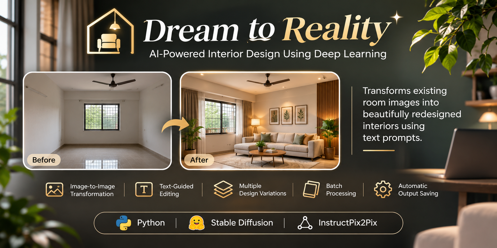
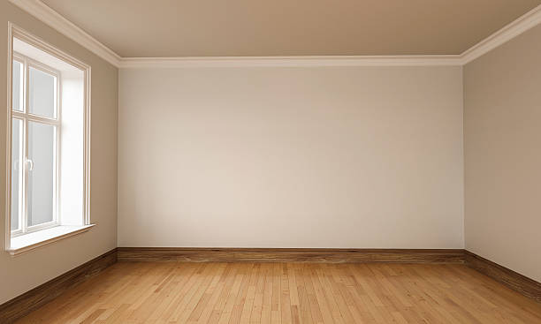
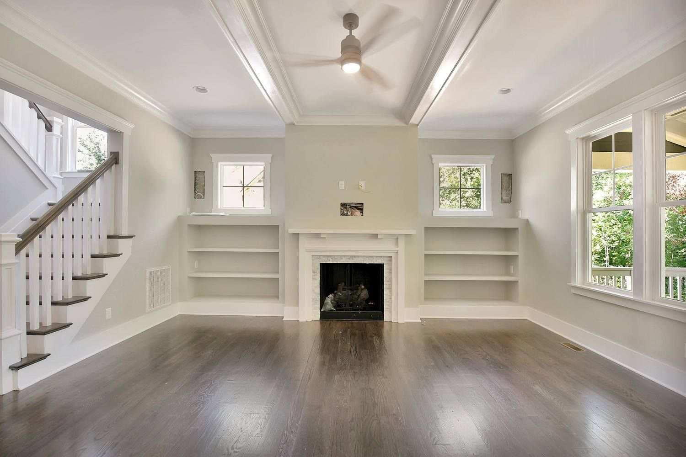

<div align="center">
  
</div>

# Dream to Reality – AI-Powered Interior Design

An AI-powered interior design application that transforms existing room images into redesigned interiors based on user-provided text prompts.

## Project Overview

Dream to Reality uses **Stable Diffusion InstructPix2Pix** to modify room images according to the user's design preferences. Users can upload an existing room image, describe the changes they want, and generate multiple redesigned variations.

## Key Features

- **Image-to-Image Transformation:** Redesigns existing room images using text instructions.
- **Text-Guided Editing:** Accepts natural-language prompts describing desired interior modifications.
- **Multiple Design Variations:** Generates multiple output images for a single input.
- **Batch Processing:** Supports processing multiple room images from a folder.
- **Image Resizing:** Resizes large images to make them suitable for processing.
- **Automatic Output Saving:** Saves generated designs as image files.

## Technologies Used

- Python
- PyTorch
- Stable Diffusion InstructPix2Pix
- Hugging Face Diffusers
- PIL (Pillow)

## How It Works

1. Load the pretrained InstructPix2Pix model.
2. Provide an existing room image.
3. Enter a text prompt describing the desired interior changes.
4. Specify the number of design variations.
5. Generate redesigned room images.
6. Save the generated outputs.

## Project Workflow

**Input Room Image → Text Prompt → InstructPix2Pix Model → AI-Generated Interior Designs**

## Sample Results

The following examples show the original room images alongside the corresponding AI-generated redesigns.

### Room 1

<table>
  <tr>
    <th align="center">Original Room</th>
    <th align="center">AI-Generated Redesign</th>
  </tr>
  <tr>
    <td align="center"></td>
    <td align="center"></td>
  </tr>
</table>

### Room 2

<table>
  <tr>
    <th align="center">Original Room</th>
    <th align="center">AI-Generated Redesign</th>
  </tr>
  <tr>
    <td align="center"></td>
    <td align="center"></td>
  </tr>
</table>

## Installation and Execution

### 1. Clone the repository

```bash
git clone https://github.com/Madhugowda2204/Interior-design-using-deep-learning.git
cd Interior-design-using-deep-learning
```

### 2. Install dependencies

```bash
pip install torch diffusers transformers accelerate safetensors pillow
```

### 3. Run the project

```bash
python main.py
```

The application will prompt you to select an image, describe the modifications, and specify how many variations to generate.

**Note:** The pretrained model is downloaded when first loaded. A compatible GPU is recommended for faster generation; the code also supports CPU execution.

## Model

Pretrained model: [timbrooks/instruct-pix2pix](https://huggingface.co/timbrooks/instruct-pix2pix)

## Project Objective

To explore the application of deep learning and text-guided image generation in interior design, making it easier to visualize different design possibilities using existing room images.

---

**Project:** Dream to Reality  
**Domain:** Artificial Intelligence | Deep Learning | Generative AI
